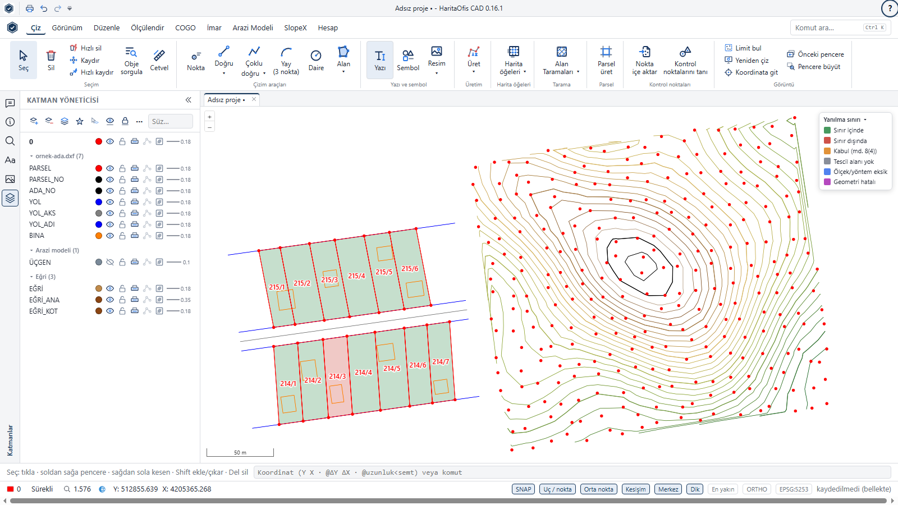
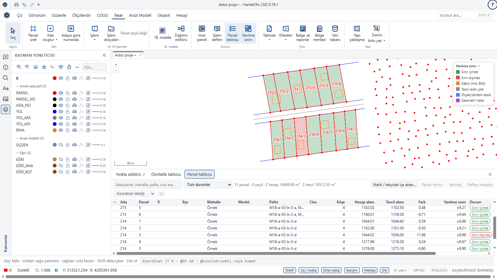
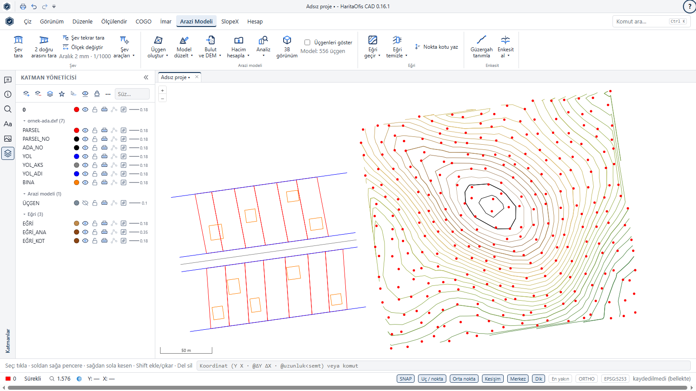
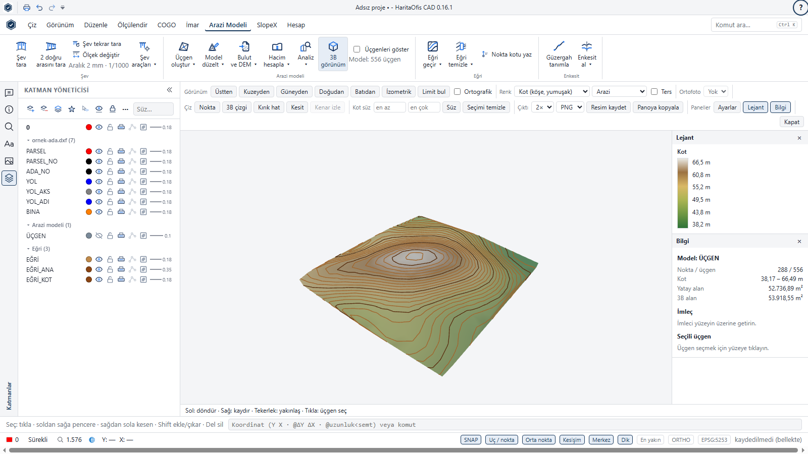
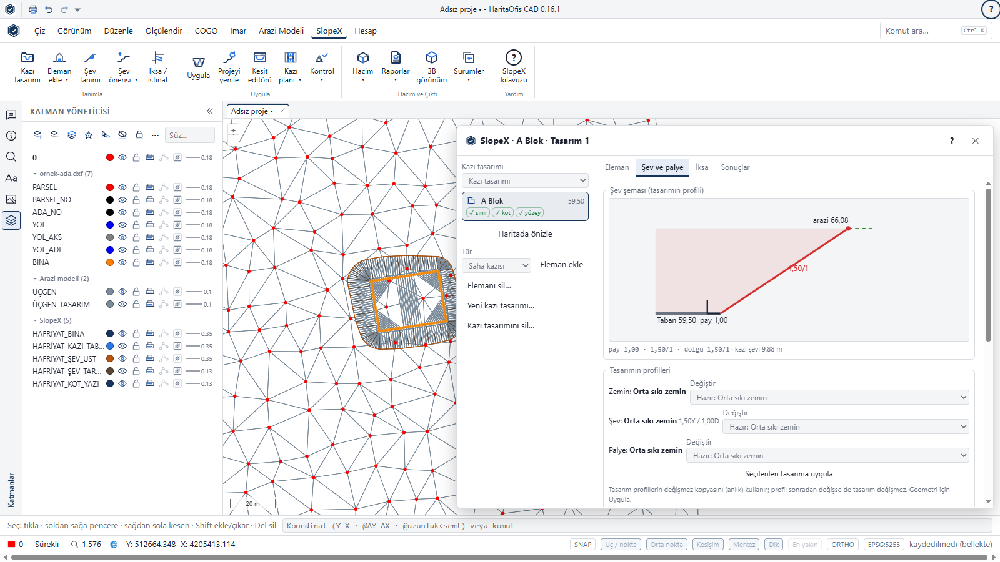
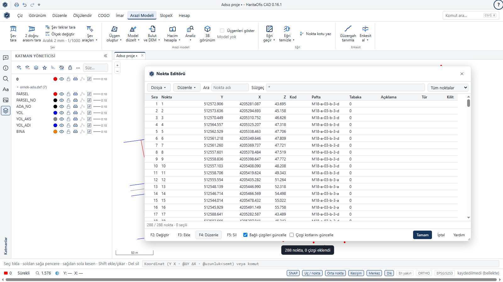

# HaritaOfis CAD

Harita ve kadastro büroları için Windows masaüstü CAD programı. Ölçü noktalarından çizime, parsel ve imar işlemlerinden arazi modeline, nokta bulutundan kazı ve şev tasarımına kadar günlük işleri tek projede toplar.

## Son sürümü indir

**[HaritaOfis-CAD-setup.exe](https://github.com/tanmert/haritaofis-cad-surumler/releases/latest/download/HaritaOfis-CAD-setup.exe)**: her zaman en son sürüm.

Sürüm notları ve eski sürümler için [Sürümler](https://github.com/tanmert/haritaofis-cad-surumler/releases) sayfasına bakın.

## Neler yapar

- **Çizim:** Programda nokta, doğru, çoklu doğru, yay, daire, yazı ve sembol çizilebilir. Katman yöneticisi, nesne yakalama ve komut paleti (Ctrl+K) çizimi kolaylaştırır.
- **Veri alışverişi:**
  - Açılan dosyalar: NCZ, DXF, DWG ve GeoCAD.
  - İçe aktarılan noktalar: TXT, CSV, NCN ve Excel.
  - Dışa aktarma: DXF, KML/KMZ ve GeoJSON.
- **İmar:**
  - Parsel üretme.
  - İfraz, tevhit, terk, ihdas ve cins değişikliği.
  - 18. madde uygulaması.
  - Belge ve raporlar.
- **Parsel denetimi:** Parsel tablosunda yanılma sınırı denetimi yapılır.
- **Arazi modeli:**
  - Üçgen ağı ve eş yükselti eğrileri.
  - Kot yazıları.
  - Hacim hesabı ve enkesit.
  - 3B görünüm.
- **Nokta bulutu, DEM ve ortofoto:**
  - LAS/LAZ nokta bulutu ve GeoTIFF yükseklik verisi (DEM) açılır, 3B'de gösterilir; ortofoto yüzeye giydirilir.
  - Sınıflanmamış buluttan zemin süzülür; buluttan ya da DEM'den otomatik plankote, üçgen ağı ve eş yükselti üretilir.
  - Noktalara ve çizgilere yüzeyden kot verilir; kontrol noktalarıyla kot doğruluğu raporlanır (RMSE).
  - 3B'de ve kesitte kotlu nokta, çizgi ve kırık hat çizilir; bordür, şev üstü gibi kenarlar yarı otomatik izlenir.
- **SlopeX (kazı ve şev tasarımı):**
  - Parselde bina temeli, saha kazısı, platform ve istinat temeli tek kazı tasarımında birleşir.
  - Kademeli şev ve palye, dolgu şevi, eğimli taban ve iksa / istinat duvarı tanımlanır; şev şeması canlı görünür.
  - Kazı kesit editörü, haritada önizleme, kazı planı ve şev kazık noktaları.
  - Kazı-dolgu hacmi, kotlar arası hacim (ör. kaya kotunun altı ayrı), raporlar ve 3B görünüm.
- **Hesap:**
  - COGO hesapları.
  - Koordinat dönüşümleri (TUREF ve ED50 TM dilimleri).
  - Projeksiyon tanımı.

## Ekran görüntüleri

**İmar:** Parseller, parsel tablosu ve yanılma sınırı denetimi.

**Arazi modeli:** Ölçü noktalarından üçgen ağı ve kota göre renklenen eş yükselti eğrileri.

**3B görünüm:** Arazi yüzeyi, kot lejantı ve alan bilgisi.

**SlopeX:** Bina temeli kazısı, şevli kazı planı ve canlı şev şeması.

**Nokta editörü:** Noktalar tablo halinde düzenlenir, aranır ve süzülür.

> Ekran görüntüleri örnek (gerçek olmayan) verilerle alınmıştır.

## Kurulum

- Windows 10 ya da 11 (64 bit) gerekir.
- Kurulum dosyası dijital olarak imzalı değildir. Windows SmartScreen uyarı verirse "Ek bilgi" ▸ "Yine de çalıştır" ile devam edin.
- Yeni sürüm ilk açıldığında "Yenilikler" penceresi o sürümde nelerin değiştiğini kısaca gösterir.

Program hesap ve çizimde yardımcıdır. Tescile konu belgeler yetkili mühendisin kontrolüyle hazırlanır.

Bu depoda yalnız kurulum dosyaları bulunur, kaynak kod yoktur.
